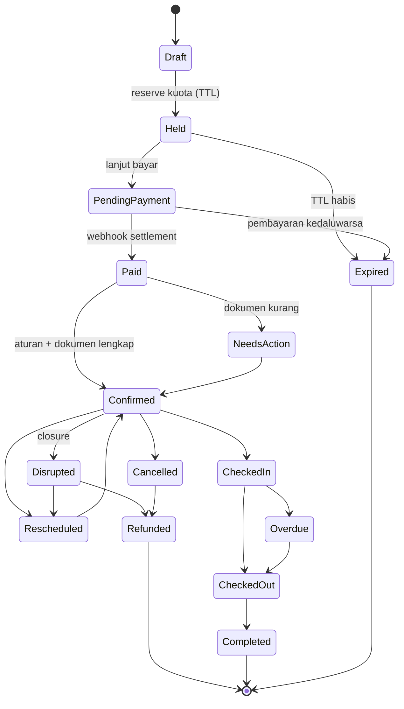
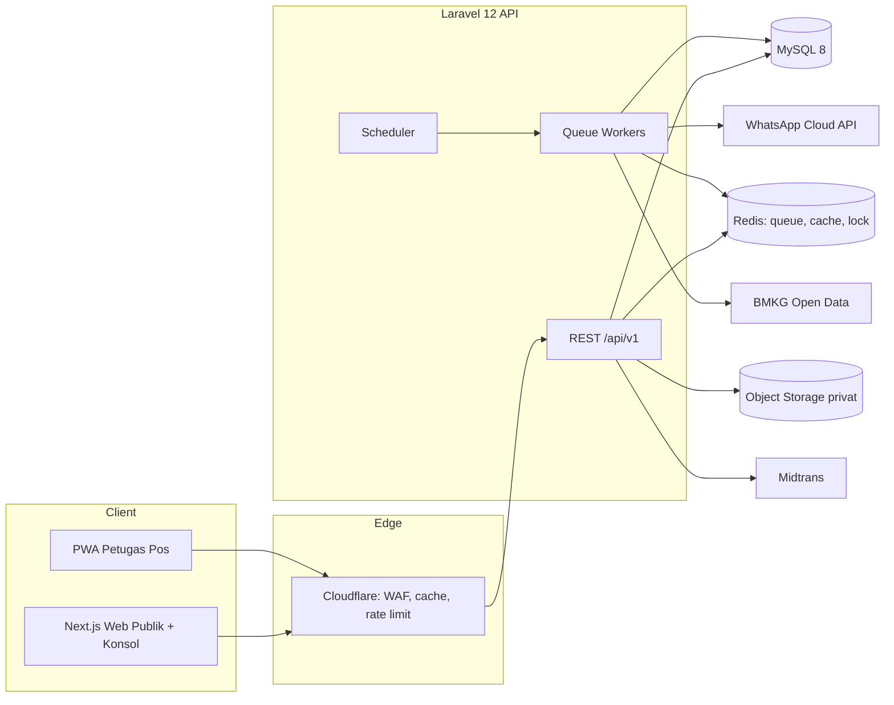
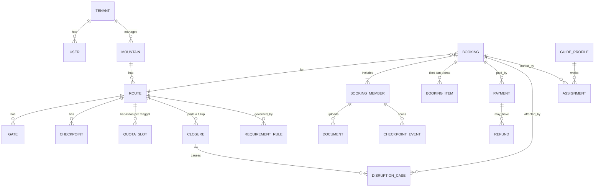
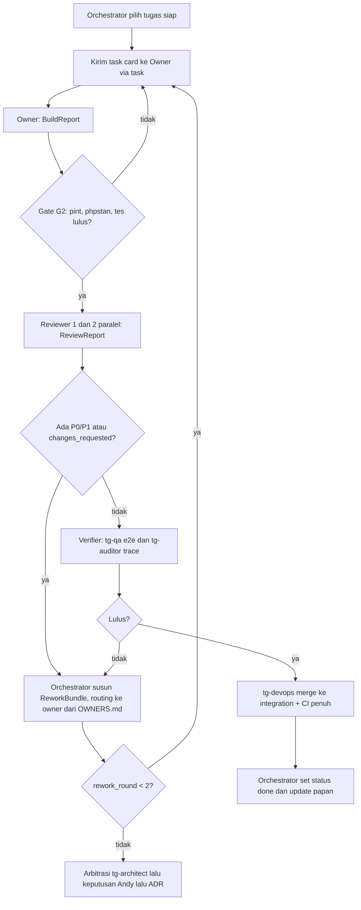

# PRD — TrailGate (nama kerja)
**Platform Booking Pendakian: SaaS multi-tenant + Template yang bisa di-deploy sendiri**

| | |
|---|---|
| Versi | 1.0 (draft siap eksekusi) |
| Tanggal | 24 November 2026 |
| Owner | Andy Pratama |
| Eksekusi | Multi-agent di **OMP (Oh My Pi)**, dengan Andy sebagai pengambil keputusan akhir |
| Konvensi label | **[FAKTA]** terverifikasi dari sumber + tanggal · **[ASUMSI]** perlu divalidasi · **[REKOMENDASI]** keputusan saya · **[VERIFIKASI]** wajib dicek agent/manusia sebelum dipakai |

---

## 0. Keputusan Inti (baca ini dulu)

| # | Keputusan | Alasan singkat |
|---|---|---|
| D1 | **SaaS-first, multi-tenant satu database (kolom `tenant_id` + global scope)**. Mode template = *build yang sama* dengan `TENANT_MODE=single`. | Satu codebase, dua model jual. DB-per-tenant terlalu berat untuk basecamp kecil. |
| D2 | **Jangan menjual ulang tiket resmi Taman Nasional.** Untuk jalur yang punya sistem resmi (TNGGP, eRinjani, TNBTS, SiPENERANG) pakai **"Official Link Mode"**: info, status buka/tutup, alert, lalu deep-link ke booking resmi. | Tiket/PNBP resmi dikelola pemerintah; risiko hukum dan reputasi. |
| D3 | Target transaksi penuh: **basecamp/pengelola jalur swadaya, trekking organizer (TO), open trip, guide/porter**, serta pengelola yang mau white-label. | Segmen yang tidak punya sistem sendiri. [ASUMSI, validasi di Discovery] |
| D4 | **Pembayaran: tiap tenant memakai akun Midtrans sendiri (BYO merchant)** di MVP. Platform tidak memegang dana. | Menghindari risiko hukum menampung dana pihak ketiga. [VERIFIKASI ke konsultan hukum] |
| D5 | **Engine kuota + penutupan jalur (closure) adalah jantung produk.** | Sepanjang 2026 jalur sering ditutup mendadak (kebakaran, JOTR, event, cuaca). Lihat §2. |
| D6 | **Rule engine persyaratan per jalur** (surat sehat, umur, rasio guide, dsb.) berbasis data + wajib `source_url` & `verified_at`. | Aturan berbeda tiap gunung dan sering berubah. |
| D7 | Stack: **Laravel 12 API + Next.js (TypeScript) + MySQL 8 + Redis**, PWA untuk petugas pos. | Sesuai keahlian Andy; PWA offline wajib karena pos pendakian sering tanpa sinyal. |
| D8 | Multi-agent OMP dengan **Orchestrator sebagai satu-satunya perantara routing**; reviewer tidak boleh mengedit kode owner. | Alur "kembalikan ke agent yang bersangkutan" harus deterministik. Lihat §16. |
| D9 | Data gunung dikelola sebagai **Mountain Pack** (file data + sumber), bukan hardcode. | Satu platform, banyak gunung, mudah diperbarui. |
| D10 | MVP dibatasi: **1–2 tenant pilot, 1–3 jalur**, bukan "semua gunung Indonesia". | Risiko terbesar adalah pasar, bukan teknologi. |

---

## 1. Ringkasan Eksekutif

**Masalah.** Pendakian di Indonesia dikelola terpecah: tiap taman nasional/Tahura punya aplikasi sendiri dengan UX, aturan, dan jadwal berbeda; basecamp swadaya masih banyak yang memakai WhatsApp + buku tamu. Jalur sering ditutup mendadak sehingga ribuan booking terdampak, dan data pendaki di lapangan (siapa yang masih di gunung) tidak real-time.

**Solusi.** TrailGate menyediakan:
1. **Untuk pengelola/basecamp/TO:** sistem booking, kuota, pembayaran, e-tiket QR, check-in/out offline, manifest real-time, dan penanganan penutupan jalur.
2. **Untuk pendaki:** satu tempat untuk menemukan jalur, memahami syarat, booking (jika tenant mendukung), atau diarahkan ke booking resmi, plus alert penutupan dan cuaca.
3. **Untuk Andy sebagai pemilik produk:** dua jalur pendapatan, yaitu langganan SaaS dan lisensi template.

**Non-goal MVP:** menggantikan sistem resmi Taman Nasional, menjual tiket resmi, e-commerce perlengkapan, aplikasi native iOS/Android.

---

## 2. Riset Domain (status per 24 Nov 2026)

### 2.1 Sistem dan aturan yang ada (semua [FAKTA] dengan sumber; paraphrase)

| Gunung / pengelola | Sistem booking | Aturan penting yang tercatat | Dinamika 2026 |
|---|---|---|---|
| **Gede-Pangrango** (BB TNGGP) | `booking.gedepangrango.org` | Wajib booking online; SIMAKSI diganti barcode berisi data pendaftaran; pendaki ilegal dikenai sanksi/daftar hitam. Dibuka lagi 13 Apr 2026 dengan gelang RFID dan kuota 300/hari dari 3 pintu. | Ditutup setelah libur panjang, Iduladha (27–28 Mei), JOTR (23–29 Jul), kebakaran (7–11 Agu, diperpanjang), lalu **ditutup tanpa batas waktu** per 1 Sep 2026. Status terkini: **[VERIFIKASI]**. Skripsi UGM 2024 menilai sistem booking belum efektif dari sisi ketersediaan dan kecukupan data. |
| **Rinjani** (BTNGR) | Aplikasi **eRinjani** (Android/iOS) | SOP revisi 2025: surat sehat diperoleh sehari sebelum mendaki, informed consent + data asuransi, di bawah 17 tahun wajib didampingi dan izin ortu, pemula wajib didampingi guide/pendaki berpengalaman. Rasio: 1 guide terdata maksimal 5 pendaki (dilaporkan turun jadi 4 sejak Jan 2026), 1 porter maksimal 2 WNA atau 3 WNI. TO wajib memastikan peralatan keselamatan. | Ditutup awal 2026, booking dibuka 6 Mar 2026 pukul 08.00 WITA; dibuka terbatas 1 Sep 2026 dengan **booking eRinjani dihentikan sementara** karena risiko kebakaran (booking yang sudah dibayar tetap dilayani); jalur Senaru dibuka lagi sekitar 3 Okt 2026. |
| **Semeru** (BB TNBTS) | Situs resmi TNBTS (domain berbeda antar sumber: `booking.bromotenggersemeru.org` / `bromotenggersemeru.id`) | Tiket online minimal H-2; check-in di Ranu Pani dengan bukti booking, identitas, surat sehat. Buka 24 Apr 2026 setelah tutup sejak 19 Nov 2025, **batas hanya sampai Ranu Kumbolo, kuota 200/hari**, kuota dibuka per bulan kalender. Reschedule: anggota tidak boleh diganti, maksimal 5 kelompok per hari. | Dilaporkan ditutup lagi awal Sep 2026 akibat karhutla Jawa Timur. Status terkini: **[VERIFIKASI]**. |
| **Arjuno-Welirang** (Tahura Raden Soerjo) | **SiPENERANG** dan aplikasi "Tiket Pendakian" | Kuota 550/hari. | Buka 7 Mei, tutup 19 Agu (kebakaran), buka 26 Sep, tutup lagi 17 Okt, **rencana buka 14 Nov 2026** (booking dibuka 12 Nov). Reschedule baru dibuka setelah asesmen. |
| **Merbabu** dan lainnya | Campuran | Penutupan jalur untuk tradisi masyarakat dan event trail run (Jul 2026). | Event/tradisi adalah sumber penutupan kedua setelah kebakaran. |

### 2.2 Data pendukung yang tersedia
- **BMKG Open Data**: prakiraan cuaca tingkat desa/kelurahan, 3 hari, interval 3 jam (suhu, kelembapan, angin, awan, jarak pandang), format JSON via `api.bmkg.go.id/publik/prakiraan-cuaca?adm4=<kode>`. **Wajib mencantumkan BMKG sebagai sumber.** (data.bmkg.go.id, diperbarui 3 Sep 2025)
- Status gunung api (PVMBG/MAGMA) dan titik panas/kebakaran (SiPongi, disebut Tahura) **[VERIFIKASI]** apakah ada API publik; rencana default: input manual oleh admin dengan tautan sumber.

### 2.3 Implikasi desain (ini yang membentuk produk)
1. **Penutupan jalur adalah kejadian normal, bukan edge case.** Sistem harus punya *Closure → Disruption Case → notifikasi → reschedule/refund* sebagai alur utama.
2. **Booking yang sudah dibayar tetap dihormati** saat penutupan baru untuk booking lanjutan (kasus Rinjani) → closure punya dua mode: `block_new_bookings` dan `cancel_existing`.
3. **Kuota bisa dibuka per bulan, tiap jalur beda kuota, tiap jalur beda aturan** → kuota per jalur per hari, dengan jendela pembukaan.
4. **Kuota itu tegas-tegas keras** (200/300/550 per hari) dan lonjakan terjadi saat booking dibuka (08.00 WITA) → atomic reservation + antrean.
5. **Reschedule punya aturan khusus** (anggota tidak boleh berubah, batas kelompok per hari) → policy engine, bukan if-else.
6. **Pendaki ilegal dan data tidak lengkap** adalah masalah nyata → manifest akurat, QR terverifikasi, check-in/out, deteksi overdue.
7. **Aturan sering berubah** → semua aturan wajib bertanggal dan bersumber.

---

## 3. Pengguna dan Kebutuhan

| Persona | Peran | Kebutuhan utama | Rasa sakit hari ini |
|---|---|---|---|
| **Rani, pendaki pemula** | Pembeli | Tahu syarat, tidak tertipu, bayar mudah, tahu jika jalur tutup | Aturan tersebar, takut tiket hangus |
| **Bayu, ketua rombongan** | Pembeli grup | Isi data 8 orang sekali, bagikan link pengisian ke anggota | Input data berulang, anggota telat kirim dokumen |
| **Pak Joko, pengelola basecamp** | Tenant admin | Kuota rapi, uang masuk jelas, laporan, tidak ribet | Buku tamu, transfer manual, rekap WhatsApp |
| **Mas Dimas, petugas pos** | Staf lapangan | Scan QR cepat, tetap jalan tanpa sinyal | Sinyal hilang, data ganda |
| **Sari, pemilik TO / open trip** | Tenant + guide | Kelola trip, penugasan guide/porter, validasi rasio | Rasio guide dicek manual, dokumen peserta tercecer |
| **Petugas BKSDA/SAR** | Pengamat | Daftar orang di gunung sekarang | Data tidak real-time |
| **Andy (owner SaaS)** | Super admin | Onboard tenant, tagihan, kesehatan platform | — |

**Jobs-to-be-done utama:** "Saat saya mau mendaki, saya ingin tahu jalur dibuka dan syaratnya, supaya saya bisa membayar sekali dan datang tanpa kejutan." / "Saat jalur ditutup, saya ingin semua peserta tahu dan uang atau jadwal tertangani tanpa saya telepon satu-satu."

---

## 4. Ruang Lingkup dan Model Produk

### 4.1 Tipe tenant
| Tipe | Transaksi | Isi |
|---|---|---|
| `managed_basecamp` | Penuh | Basecamp/pengelola jalur swadaya: kuota, tiket, pos, laporan |
| `trek_operator` | Penuh | TO/open trip: trip, peserta, guide/porter, dokumen |
| `official_link` | **Tidak ada** | Halaman info + status + alert + deep-link ke booking resmi |
| `white_label_authority` | Penuh (fase 3) | Pengelola resmi yang membeli lisensi (butuh proses legal terpisah) |

### 4.2 Dua cara menjual
- **SaaS:** `tenant.trailgate.id` (atau domain kustom), langganan bulanan + fee transaksi.
- **Template:** paket single-tenant (Docker compose, seed, dokumentasi, lisensi), harga sekali bayar + opsi support. Build identik, hanya konfigurasi berbeda.

### 4.3 Di luar lingkup MVP
Aplikasi native, pembayaran multi-merchant otomatis dengan split dana, marketplace peralatan, asuransi terintegrasi, integrasi langsung ke sistem resmi pemerintah (tidak ada API publik yang diketahui [VERIFIKASI]).

---

## 5. Kebutuhan Fungsional

Prioritas MoSCoW: **M**ust · **S**hould · **C**ould. Fase: P1 MVP · P2 Safety & Ops · P3 Marketplace & SaaS.

| ID | Kebutuhan | Prio | Fase |
|---|---|---|---|
| FR-01 | Organisasi/tenant, user, RBAC (super admin, tenant admin, kasir, petugas pos, guide, pendaki) | M | P1 |
| FR-02 | Branding tenant (logo, warna, subdomain) | M | P1 |
| FR-03 | Katalog: gunung, jalur, gate/basecamp, pos/checkpoint, camp area | M | P1 |
| FR-04 | Peta rute (GeoJSON) + profil elevasi | M (peta) / S (elevasi) | P1 |
| FR-05 | Kuota per jalur per tanggal, jendela pembukaan booking, cutoff H-n | M | P1 |
| FR-06 | Reservasi sementara (hold) dengan TTL, anti-overbooking | M | P1 |
| FR-07 | Closure (penuh/sebagian jalur/sebagian hari) + Disruption Case (notifikasi, reschedule, refund) | M | P1 |
| FR-08 | Rule engine persyaratan per jalur (umur, surat sehat, consent, rasio guide, ukuran grup, dokumen) | M | P1 |
| FR-09 | Booking grup: ketua + anggota + kontak darurat; link pengisian untuk anggota | M | P1 |
| FR-10 | Dokumen: surat sehat, izin ortu, consent, bukti asuransi (penyimpanan privat) | M | P1 |
| FR-11 | Pricing engine: WNI/WNA, weekday/weekend/libur, promo, item tambahan | M | P1 |
| FR-12 | Item tambahan: guide, porter, sewa alat, transport, homestay, asuransi | S | P2 |
| FR-13 | Pembayaran Midtrans (Snap, VA, QRIS), webhook idempoten, rekonsiliasi | M | P1 |
| FR-14 | Policy engine refund/reschedule per tenant dan per kejadian | M | P1 |
| FR-15 | E-tiket QR bertanda tangan + PDF | M | P1 |
| FR-16 | PWA petugas pos: check-in/out, offline, sinkron | M | P1 |
| FR-17 | Manifest + headcount real-time; deteksi **overdue** | M (manifest) / S (overdue) | P1/P2 |
| FR-18 | Notifikasi WhatsApp Cloud API + email (template, opt-in) | M | P1 |
| FR-19 | Konsol admin: dashboard, kelola booking, laporan Excel/PDF | M | P1 |
| FR-20 | Audit log semua aksi sensitif | M | P1 |
| FR-21 | Cuaca BMKG per jalur dengan atribusi | S | P2 |
| FR-22 | SOS/kontak darurat, ekspor manifest untuk SAR | S | P2 |
| FR-23 | Briefing keselamatan digital + kuis singkat | S | P2 |
| FR-24 | Profil guide/porter, sertifikasi, ketersediaan | S | P2 |
| FR-25 | Penugasan guide/porter + validasi rasio otomatis | S | P2 |
| FR-26 | i18n ID/EN, alur WNA (paspor) | M (ID) / S (EN) | P1/P2 |
| FR-27 | Perlindungan lonjakan: rate limit, antrean (waiting room), idempotency key | M | P1 |
| FR-28 | Billing langganan SaaS + metering | M | P3 |
| FR-29 | Domain kustom per tenant | S | P3 |
| FR-30 | Open trip (gabung trip, patungan biaya) | C | P3 |
| FR-31 | Sewa alat dan homestay (inventori) | C | P3 |
| FR-32 | API publik + widget embed | S | P3 |
| FR-33 | Paket template single-tenant (installer, docs, lisensi) | M | P3 |
| FR-34 | Laporan kondisi jalur + ulasan | C | P3 |
| FR-35 | **Official Link Mode** (info + alert + deep-link) | M | P1 |
| FR-36 | Privasi: consent, retensi, ekspor/hapus data, enkripsi field sensitif | M | P1 |
| FR-37 | Import Mountain Pack dengan validator sumber (`source_url`, `verified_at`) | M | P1 |
| FR-38 | Deklarasi logistik/sampah + deposit sampah opsional | S | P2 |
| FR-39 | Design system sendiri: token, Tailwind v4, `packages/ui`, tema tenant dengan validator kontras | M | P1 |
| FR-40 | Dashboard konsol buatan sendiri: shell, RBAC nav, tabel data, widget operasional, mobile-usable | M | P1 |
| FR-41 | Landing pemasaran + landing tenant berbasis blok, target Lighthouse §9.4 | M | P1 |

---

## 6. Business Rules dan Rule Engine

### 6.1 Prinsip
- Aturan = **data**, bukan kode. Disimpan di `requirement_rules` dengan cakupan (`tenant|mountain|route`), masa berlaku, sumber, dan tanggal verifikasi.
- Evaluator mengembalikan daftar hasil `{severity: block|warn, code, message_id, message_en, member_ref}`.
- Aturan tanpa `source_url` atau dengan `verified_at` lebih dari 90 hari → CI gagal (seeder) / badge "perlu verifikasi" (runtime).

### 6.2 Tipe aturan yang didukung
`min_age_unaccompanied`, `minor_requires_guardian_consent`, `beginner_requires_guide`, `health_cert_max_age_hours`, `informed_consent_required`, `insurance_info_required`, `guide_ratio`, `porter_ratio`, `max_group_size`, `min_group_size`, `booking_window_days`, `booking_cutoff_hours`, `max_stay_nights`, `required_documents[]`, `reschedule_policy`, `refund_policy`, `quota_open_schedule`.

### 6.3 Contoh (ilustrasi dari sumber di §2; bukan data final)
```json
{
  "scope": "route", "route_slug": "rinjani-sembalun",
  "rules": [
    { "type": "health_cert_max_age_hours", "params": { "hours": 24 }, "severity": "block" },
    { "type": "minor_requires_guardian_consent", "params": { "under_age": 17 }, "severity": "block" },
    { "type": "guide_ratio", "params": { "max_hikers_per_guide": 4 }, "severity": "block" },
    { "type": "porter_ratio", "params": { "foreign": 2, "domestic": 3 }, "severity": "block" }
  ],
  "source_url": "https://lestari.kompas.com/read/2025/08/13/225800186/gunung-rinjani-kembali-dibuka-tapi-pengunjung-tak-bisa-sembarangan-mendaki",
  "verified_at": "2026-11-24",
  "note": "Rasio guide dilaporkan 5 lalu 4 sejak Jan 2026. VERIFIKASI ke SOP resmi terbaru."
}
```

### 6.4 Kebijakan inti (default, dapat diubah tenant)
| Topik | Default |
|---|---|
| Hold | 15 menit; dilepas otomatis oleh job terjadwal |
| Pembayaran | Kedaluwarsa 60 menit setelah hold berakhir tidak berlaku; pembayaran harus selesai dalam masa hold + grace 5 menit |
| Closure `block_new_bookings` | Booking baru ditolak; booking yang sudah dibayar tetap sah |
| Closure `cancel_existing` | Buat Disruption Case untuk setiap booking terdampak; pilihan pendaki: reschedule gratis atau refund penuh |
| Reschedule | Anggota tidak boleh berubah; batas jumlah kelompok reschedule per hari (konfigurasi); satu kali gratis [ASUMSI] |
| Refund | Ditentukan tenant; closure oleh otoritas selalu refund penuh atau reschedule |
| No-show | Tiket hangus sesuai policy; slot dilepas setelah jam batas check-in |

---

## 7. Alur Kunci

### 7.1 State machine booking


### 7.2 Alur pendaki (happy path)
1. Cari jalur → lihat status (buka/tutup), kuota tersisa, cuaca, syarat.
2. Pilih tanggal + jumlah → **hold** kuota.
3. Isi data ketua → bagikan link ke anggota (tiap anggota isi data + unggah dokumen sendiri).
4. Evaluasi rule engine (blok jika tidak memenuhi).
5. Bayar (Midtrans) → webhook → `Paid` → `Confirmed` bila dokumen lengkap.
6. Terima e-tiket QR (WA + email) + briefing keselamatan.
7. Hari H: scan di pos → `CheckedIn`; turun: scan → `CheckedOut`.

### 7.3 Alur penutupan jalur (Closure Desk)
1. Admin tenant (atau **tg-domain** mengusulkan dari berita; **manusia wajib konfirmasi**) membuat closure: jalur, rentang tanggal, mode, alasan, **nomor/tautan surat resmi**.
2. Sistem menghitung booking terdampak → membuat Disruption Case.
3. Broadcast WA/email ke seluruh peserta terdampak + pendaki yang berlangganan jalur itu.
4. Pendaki memilih reschedule/refund melalui tautan; refund dieksekusi lewat policy engine.
5. Dashboard menampilkan progres penyelesaian kasus.

### 7.4 Official Link Mode
Halaman jalur menampilkan: status (sumber + tanggal), ringkasan aturan (dengan tanggal verifikasi), cuaca, tombol "Booking di situs resmi", dan "Beri tahu saya jika dibuka" (alert). **Tidak ada transaksi.**

---

## 8. Kebutuhan Non-Fungsional

| Area | Target | Catatan |
|---|---|---|
| Kebenaran kuota | **0 overbooking** (invarian keras) | Diuji dengan tes konkurensi |
| Lonjakan | Tahan 300 permintaan booking/detik selama 10 menit pada pembukaan kuota [ASUMSI, kalibrasi dari pilot] | Antrean + rate limit + operasi atomik |
| Latensi | API p95 < 400 ms (non-pembayaran); halaman publik LCP < 2,5 s di 4G | |
| Ketersediaan | 99,5% MVP; 99,9% saat >10 tenant | Maintenance window di luar jam buka kuota |
| Offline | PWA pos jalan penuh tanpa sinyal ≥ 24 jam; sinkron saat online | Konflik: *first scan wins* + log |
| Keamanan | OWASP ASVS L2 sebagai acuan; pengujian isolasi tenant otomatis | |
| Privasi | Kepatuhan UU PDP No. 27/2022 [VERIFIKASI ke konsultan]; NIK dan dokumen terenkripsi | |
| Aksesibilitas | WCAG 2.2 AA untuk alur booking | |
| Perangkat | Android murah, layar kecil, jaringan lambat | Bundle ringan, gambar responsif |
| Observabilitas | Error tracking, metrik antrean, alert webhook gagal, alert kuota anomali | |
| Backup | RPO ≤ 15 menit, RTO ≤ 2 jam; uji restore tiap kuartal | |
| Lokasi data | Hosting di Indonesia disarankan [VERIFIKASI kewajiban] | |
| Lokalisasi | Bahasa Indonesia penuh; Inggris untuk WNA; zona waktu WIB/WITA/WIT per jalur | Pembukaan kuota Rinjani memakai WITA |

---

## 9. Arsitektur, Stack, dan Plugin

### 9.1 Arsitektur

Monorepo: `apps/api` (Laravel), `apps/web` (Next.js: publik + konsol), `apps/pos` (PWA; boleh satu app Next dengan route group terpisah), `packages/contracts` (OpenAPI + tipe TS yang di-generate), `packages/design-tokens`, `docs/`, `infra/`.

### 9.2 Daftar paket/plugin (verdict)
> Versi **tidak** saya patok di dokumen ini. Agent `tg-devops` wajib mengecek Packagist/npm saat scaffold, mem-pin versi, lalu mencatat di ADR.

**Backend (Laravel)**
| Paket | Fungsi | Verdict |
|---|---|---|
| `laravel/sanctum` | Auth SPA + token | Wajib |
| `spatie/laravel-permission` | RBAC (di-scope per tenant) | Wajib |
| `spatie/laravel-activitylog` | Audit log (FR-20) | Wajib |
| `spatie/laravel-data` | DTO terketik untuk kontrak API | Disarankan |
| `spatie/laravel-query-builder` | Filter/sort/paginate konsisten | Disarankan |
| `spatie/laravel-medialibrary` | Upload dokumen/gambar (disk privat + signed URL) | Disarankan |
| `spatie/laravel-backup` | Backup terjadwal | Wajib |
| `spatie/laravel-health` | Health check endpoint | Disarankan |
| `spatie/laravel-settings` | Setting per tenant bertipe | Opsional |
| `laravel/horizon` | Monitor queue Redis | Wajib |
| `laravel/pulse` | Metrik aplikasi | Disarankan |
| `sentry/sentry-laravel` | Error tracking | Disarankan |
| `midtrans/midtrans-php` | Snap/VA/QRIS + verifikasi signature | Wajib |
| `endroid/qr-code` | Render QR | Disarankan |
| `spatie/laravel-pdf` atau `barryvdh/laravel-dompdf` | PDF tiket/manifest | Pilih satu (dompdf lebih sederhana) |
| `maatwebsite/excel` | Ekspor laporan | Disarankan |
| `dedoc/scramble` | Dokumentasi OpenAPI otomatis | Opsional; **contracts-first tetap sumber kebenaran** |
| `larastan/larastan` | PHPStan untuk Laravel | Wajib |
| `laravel/pint` | Code style | Wajib |
| PHPUnit (Pest opsional) | Tes | Wajib |
| `brick/money` | Uang tanpa float | Disarankan |
| `stancl/tenancy` / DB-per-tenant | — | **Hindari di awal** (kompleksitas) |

**Frontend**
| Paket | Fungsi | Verdict |
|---|---|---|
| Next.js (App Router) + TypeScript | Web publik (SSR/SEO) + konsol | Wajib |
| Tailwind CSS + shadcn/ui | UI cepat dan konsisten | Wajib |
| TanStack Query | Data fetching/cache | Wajib |
| React Hook Form + Zod | Form wizard + validasi | Wajib |
| `next-intl` | i18n ID/EN | Wajib |
| MapLibre GL JS (+ `react-map-gl`) | Peta rute | Wajib; tile: self-host PMTiles atau penyedia berlisensi **[VERIFIKASI kebijakan tile OSM publik]** |
| Serwist (`@serwist/next`) atau service worker kustom | PWA offline | Wajib untuk pos [VERIFIKASI kompatibilitas versi Next] |
| Dexie (IndexedDB) | Antrean scan offline | Disarankan |
| Recharts | Grafik dashboard | Opsional |
| Playwright | E2E | Wajib |
| Vitest + Testing Library | Unit/komponen | Disarankan |
| `@axe-core/playwright` | Cek aksesibilitas | Disarankan |

**Infra**: Docker, Nginx, MySQL 8, Redis, S3-compatible storage privat, Cloudflare, GitHub Actions, k6 (load test).

### 9.3 Tooling OMP yang dipakai
| Fitur OMP | Dipakai untuk |
|---|---|
| `task` (subagent paralel di worktree terisolasi, hasil yield tervalidasi skema) | Eksekusi tiap tugas oleh agent owner |
| `/review` (reviewer P0–P3 + verdict) | Code review sebelum merge |
| `lsp`, `ast_grep` | Refactor aman, deteksi pola terlarang |
| `security_scan` (setting-gated) | Gate keamanan |
| `github` (setting-gated), `browser`, `web_search` | PR, uji UI, riset domain (Domain agent) |
| Role model `smol/default/slow/plan/advisor` | Routing biaya vs kualitas per seat |
| Agent Hub (`Alt+A`), `/agents` | Pantau, steer, revive worker |
| Paket `@loneexile/omp-superpowers` | Basis alur subagent-driven-development (`sdd-*`) |

### 9.4 Fondasi UI: Tailwind, Dashboard, dan Landing Page (dibangun sendiri)

**Keputusan [REKOMENDASI]:** tidak memakai template admin atau tema siap pakai. Tailwind, design system, dan dashboard dibangun dari nol di repo ini supaya bisa di-white-label per tenant dan ikut terjual dalam paket template.

**A. Tailwind + design system (milik `tg-ux`, dipakai `tg-web`/`tg-console`)**
| Item | Standar |
|---|---|
| Versi Tailwind | v4, konfigurasi CSS-first (`@import "tailwindcss"` + `@theme`). Versi di-pin `tg-devops` saat scaffold [VERIFIKASI] |
| Token | Satu sumber di `packages/design-tokens` (warna, tipografi, spasi, radius, bayangan, motion) → dihasilkan jadi CSS variables → dipetakan ke `@theme`. Dilarang warna/ukuran hardcode di komponen |
| Tema tenant | Warna merek tenant di-inject sebagai CSS variables saat runtime. Validator kontras WCAG AA otomatis: warna yang gagal ditolak atau disesuaikan |
| Mode gelap | Token terang dan gelap sejak awal (petugas pos sering bekerja malam/di luar ruangan) |
| Komponen | `packages/ui` berbasis shadcn/ui yang **disalin dan dimiliki sendiri** (bukan dependensi tertutup): Button, Input, Select, Dialog, Sheet, Tabs, Toast, DataTable, Calendar kuota, StatusBadge jalur, QuotaMeter, Stepper booking |
| Aturan | Komponen wajib ada di Storybook/halaman katalog internal, lulus axe, dan punya state loading/empty/error |
| Performa | CSS hasil build dibatasi (budget ukuran di CI); tanpa font eksternal berat; font dengan fallback |

**B. Dashboard (konsol tenant + super admin), dibangun sendiri, dimiliki `tg-console`**
| Item | Standar |
|---|---|
| Shell | Sidebar + topbar responsif, navigasi berbasis peran (RBAC), pemilih tenant (super admin), command palette (Ctrl+K), breadcrumb, notifikasi |
| Tabel data | TanStack Table: filter, sort, paginasi server-side, ekspor, kolom bisa diatur, aksi massal |
| Widget wajib | Okupansi kuota per jalur (7/30 hari), pendapatan, booking menunggu bayar/dokumen, **Kasus Penutupan terbuka**, orang di gunung sekarang, overdue, cuaca jalur, anomali webhook |
| Halaman | Kalender kuota, Closure Desk, booking, manifest, aturan jalur, laporan, tim/peran, pengaturan merek, audit log, billing (P3) |
| Super admin | Tenant, kesehatan sistem (queue, webhook gagal), tagihan, flag fitur |
| Kualitas | Skeleton loading, empty state yang memberi aksi, optimistic UI hanya untuk aksi aman, semua aksi sensitif minta konfirmasi + masuk audit log |
| Mobile | Dashboard tetap usable di ponsel (pengelola basecamp banyak memakai HP) |

**C. Landing page (peningkatan di atas baseline), dimiliki `tg-web` + `tg-ux`**
Dua landing: (1) **landing pemasaran TrailGate** untuk menjual SaaS/template, (2) **landing per tenant** dari blok yang bisa diatur.

| Aspek | Standar peningkatan |
|---|---|
| Hero | Bukan slogan generik: menampilkan **status jalur dan kuota hidup** (contoh data DEMO) dan satu CTA utama ("Coba demo" / "Cek jalur") |
| Struktur | Hero → bukti kepercayaan → masalah (jalur sering tutup, data tercecer) → cara kerja 3 langkah → fitur per persona (pendaki, basecamp, TO) → papan status gunung → harga → FAQ → CTA akhir |
| Copy | Bahasa Indonesia natural, spesifik ke kasus nyata (penutupan jalur, rasio guide, surat sehat); tidak ada klaim tanpa sumber |
| Visual | Peta rute dan profil elevasi interaktif, ilustrasi/foto ringan (AVIF/WebP, lazy), motion halus dan menghormati `prefers-reduced-motion` |
| Konversi | Satu CTA utama per layar, formulir demo/waitlist pendek, WhatsApp sebagai kanal alternatif, pelacakan event (tanpa cookie pihak ketiga yang tak perlu) |
| SEO | SSR/SSG, metadata dan Open Graph per halaman, skema terstruktur, sitemap, halaman jalur per gunung (konten bersumber dari Mountain Pack) |
| Target kualitas | Lighthouse (mobile, 4G): Performance ≥ 95, Accessibility 100, Best Practices ≥ 95, SEO ≥ 95; LCP < 2,0 s, CLS < 0,05; diuji di CI |
| Blok tenant | Hero, jalur unggulan, status/closure, galeri, FAQ, kontak, peta; tenant mengatur urutan dan isi tanpa kode |
| Template | Landing tenant ikut paket template (FR-33) dan bisa diganti merek penuh |

---

## 10. Model Data dan Algoritma Kuota

### 10.1 ERD ringkas


### 10.2 Tabel kunci dan catatan
| Tabel | Kolom/Aturan penting |
|---|---|
| `tenants` | `type`, `slug`, `status`, `settings` (JSON), `midtrans_*` (terenkripsi) |
| `routes` | `mountain_id`, `geojson`, `timezone`, `max_group_size`, `booking_open_schedule` |
| `quota_slots` | `UNIQUE(route_id, date)`, `capacity`, `reserved`, `sold`, `version` |
| `closures` | `route_id`, `starts_at`, `ends_at`, `mode`, `reason`, `source_url`, `source_ref` (no. surat), `created_by`, `confirmed_by` |
| `requirement_rules` | `scope`, `type`, `params` JSON, `source_url` NOT NULL, `verified_at` NOT NULL, `effective_from/to` |
| `bookings` | `code` unik, `idempotency_key` unik, `status`, `hold_expires_at`, `total_amount` (integer rupiah) |
| `booking_members` | NIK/paspor **terenkripsi**, `is_foreign`, `birth_date`, `ticket_token_id` |
| `checkpoint_events` | `member_id`, `checkpoint_id`, `type(in/out)`, `scanned_at`, `device_id`, `client_event_id` UNIQUE (idempotensi offline) |
| `payments` | `provider_ref` unik, `raw_payload`, `status`, `settled_at` |
| `ledger_entries` | Buku besar append-only (pembayaran, refund, fee) |
| `audit_logs` | Siapa, apa, kapan, sebelum/sesudah |

Semua tabel tenant-scoped memiliki `tenant_id` + index komposit; **global scope** + tes yang gagal bila ada model tenant-scoped tanpa scope.

### 10.3 Reservasi kuota (invarian: `reserved + sold <= effective_capacity`)
```sql
-- dalam transaksi
UPDATE quota_slots
   SET reserved = reserved + :n, version = version + 1
 WHERE route_id = :r AND date = :d
   AND reserved + sold + :n <= :effective_capacity;   -- affected_rows = 1 atau gagal
```
- `effective_capacity = closure aktif ? 0 : capacity` dihitung di service, bukan di klien.
- Hold dilepas oleh job (`reserved -= n`); pembayaran sukses memindahkan `reserved → sold` dalam satu transaksi.
- Redis hanya untuk antrean/rate limit/lock tambahan; **sumber kebenaran tetap MySQL**.
- Semua endpoint tulis menerima `Idempotency-Key`.
- Tes wajib: 500 request paralel ke slot kapasitas 10 → tepat 10 sukses.

### 10.4 Tiket QR
Token bertanda tangan (Ed25519 atau HMAC) berisi `ticket_id`, `member_id`, `route_id`, `valid_date`. POS menyimpan kunci publik + daftar revoke, sehingga verifikasi bisa offline. Tiket yang sudah dipindai dua kali menampilkan peringatan, bukan crash.

---

## 11. Rancangan API (v1, contracts-first)

| Area | Endpoint contoh |
|---|---|
| Publik | `GET /v1/routes`, `GET /v1/routes/{slug}`, `GET /v1/routes/{slug}/availability?from&to`, `GET /v1/routes/{slug}/status` |
| Booking | `POST /v1/bookings` (hold), `PUT /v1/bookings/{code}/members/{id}`, `POST /v1/bookings/{code}/pay`, `POST /v1/bookings/{code}/reschedule`, `POST /v1/bookings/{code}/cancel` |
| Dokumen | `POST /v1/members/{id}/documents` (signed upload), `GET` via signed URL |
| Pembayaran | `POST /v1/webhooks/midtrans/{tenant}` (verifikasi signature, idempoten) |
| Konsol | `/v1/console/quota`, `/closures`, `/disruptions`, `/bookings`, `/reports`, `/rules` |
| POS | `POST /v1/pos/sync` (batch event dengan `client_event_id`), `GET /v1/pos/manifest`, `GET /v1/pos/revocations` |
| Super admin | `/v1/admin/tenants`, `/billing` |

Aturan: versi di URL, error terstandar (`code`, `message`, `details`), pagination konsisten, rate limit per IP/akun/tenant, OpenAPI di `packages/contracts` adalah sumber kebenaran; tipe TS di-generate.

---

## 12. Integrasi

| Integrasi | Detail | Catatan |
|---|---|---|
| Midtrans | Snap, VA, QRIS; webhook; sandbox dulu | BYO merchant; simpan kunci terenkripsi; verifikasi signature; rekonsiliasi harian |
| WhatsApp Cloud API | Template pesan: tiket, pengingat H-1, closure, overdue | Wajib opt-in; template disetujui Meta |
| BMKG Open Data | Cuaca per `adm4` dengan cache | **Wajib atribusi BMKG**; fallback jika API gagal |
| Status gunung api/karhutla | Input manual + tautan sumber (default) | Jangan scraping tanpa izin |
| Object storage | Disk privat + signed URL berumur pendek | |
| (P3) Penyedia asuransi | Belum ditentukan | |

---

## 13. Keamanan, Privasi, Kepatuhan

| Risiko | Kontrol |
|---|---|
| Kebocoran antar tenant | Global scope, policy per tenant, tes isolasi otomatis (CI gagal bila ada query tanpa scope), uji penetrasi di E10 |
| Data identitas (NIK, paspor, surat sehat) | Enkripsi field (cast terenkripsi), disk privat, signed URL, retensi (hapus dokumen N hari setelah pendakian, konfigurasi), akses dicatat |
| Webhook palsu | Verifikasi signature, cek status ke API Midtrans, idempoten |
| Bot/scalper saat pembukaan kuota | Rate limit, antrean, captcha adaptif, batas booking per identitas per hari |
| QR palsu | Tanda tangan kriptografis, revoke list, nonce |
| Akun pegawai bocor | MFA untuk tenant admin, sesi pendek, audit log |
| Hukum | UU PDP 27/2022, PSE privat, perlindungan konsumen, kebijakan refund jelas [VERIFIKASI semua ke konsultan] |
| Rantai pasok | Pin versi, `composer audit` dan `npm audit` di CI, paket baru butuh persetujuan Security |
| Rahasia | Tidak ada kunci di repo; `.env` di secret manager; pemindaian rahasia di CI |

---

## 14. Monetisasi (hipotesis, validasi lewat wawancara)

| Paket | Harga hipotesis | Isi |
|---|---|---|
| Pilot | Gratis 3 bulan | 1 basecamp, bantuan onboarding, umpan balik terstruktur |
| Basecamp | Rp 299.000/bln + 1% transaksi | 1 gunung, 3 jalur, 5 staf |
| Pro / TO | Rp 899.000/bln + 1% | Multi-jalur, guide/porter, laporan lanjut, WA |
| Lisensi Template | Rp 15–40 juta sekali bayar [ASUMSI] | Single-tenant, kode sumber, docs, 90 hari support |

Fee transaksi memakai akun Midtrans tenant (BYO), sehingga penagihan fee platform dilakukan terpisah (invoice bulanan) [VERIFIKASI mekanisme].

**Metrik sukses**
| Metrik | Target 90 hari setelah pilot |
|---|---|
| Overbooking | 0 |
| Konversi hold → bayar | ≥ 60% |
| Waktu check-in per rombongan | < 60 detik |
| Disruption case selesai < 72 jam | ≥ 90% |
| Tenant aktif berbayar | 3 |
| Deteksi overdue → alert | < 15 menit |

---

## 15. Roadmap

| Fase | Durasi (estimasi solo + agent) | Isi | Exit criteria |
|---|---|---|---|
| **P0 Discovery & Fondasi** | Minggu 1–2 | Wawancara 5 basecamp + 3 TO, Mountain Pack referensi, ADR, kontrak API, scaffold, CI, roster agent | Gate G0: 2 pilot bersedia; keputusan D1–D10 dikonfirmasi |
| **P1 MVP** | Minggu 3–10 | FR M fase P1 | Pilot live 1 jalur; 0 overbooking di tes; tenant isolation lulus |
| **P2 Safety & Ops** | Minggu 11–16 | Cuaca, overdue, guide/porter, EN, extras, deposit sampah | Satu insiden simulasi (overdue + closure) tertangani end-to-end |
| **P3 SaaS & Template** | Minggu 17–24 | Billing, domain kustom, widget, paket template | Tenant ke-3 onboard tanpa bantuan koding; template terpasang di server bersih < 30 menit |

[ASUMSI] Estimasi berasumsi satu developer manusia + agent paralel; kalibrasi ulang setelah sprint pertama.

---

## 16. Operating Model Multi-Agent di OMP

### 16.1 Mekanika OMP yang jadi dasar (terverifikasi dari README dan changelog)
- `task` memecah pekerjaan ke subagent paralel di **worktree terisolasi**; hasil akhir (`yield`) berupa objek **tervalidasi skema** yang dibaca parent.
- Agent kustom: **`.omp/agents/`** (proyek) dan `~/.omp/agent/agents/` (pengguna); `/agents` membuka dashboard untuk membuat/mengatur.
- Peer dapat berkoordinasi lewat **IRC DM**, namun README sendiri mencatat contoh *handshake satu arah* → **jangan jadikan DM sebagai satu-satunya bukti kesepakatan**.
- Hasil subagent dapat dibaca per-field lewat skema URL `agent://<id>/...`; tool `wait` memblokir sampai hasil/pesan peer datang.
- Agent Hub (`Alt+A`): lihat transkrip, kirim steering, **revive worker yang diparkir**, matikan worker macet.
- Role model: `default`, `smol`, `slow`, `plan`, `task`, `advisor`, dll.; override per agent lewat `task.agentModelOverrides` (di `~/.omp/agent/config.yml` atau `/agents`). Role **advisor** = model kedua yang membaca tiap giliran agen utama dan menyisipkan catatan.
- Kata kunci prompt: `orchestrate` (jalankan kerja independen lewat subagent paralel + verifikasi tiap fase), `workflowz` (bangun alur multi-subagent deterministik); mode `/vibe` (direktur dengan toolset read-only mengarahkan worker).
- `omp plugin install npm:@loneexile/omp-superpowers` memberi seat `sdd-implementer`, `sdd-reviewer`, `sdd-rereviewer`, `sdd-escalation-implementer`, `sdd-final-reviewer`. Nama agent bawaan bervariasi antar versi; **cek roster dengan:**
  `omp -p --no-session 'List the agent type names your task tool offers, comma-separated, nothing else.'`
- `lsp`/`ast_grep` di subagent hanya aktif jika `task.enableLsp` / `astGrep.enabled` dinyalakan; tool `github`, `security_scan`, dan memori bersifat setting-gated (default mati). **[VERIFIKASI nama setting di versi terpasang]**

### 16.2 Prinsip operasi
1. **Orchestrator-mediated routing.** Subagent mengembalikan hasil ke parent, bukan langsung ke agent lain. Maka "mengembalikan pekerjaan ke agent yang bersangkutan" = Orchestrator membuka `task` baru (atau revive worker) untuk **owner** dengan paket temuan. Ini deterministik dan terekam.
2. **Satu owner per path** (`OWNERS.md`). Reviewer **tidak boleh** mengedit file owner; ia hanya melaporkan temuan terstruktur.
3. **Tidak ada self-approval.** Reviewer ≠ Owner; Verifier ≠ Owner ≠ Reviewer.
4. **Semua kesepakatan tertulis di repo** (kontrak OpenAPI, ADR, task card). DM antar-agent hanya untuk klarifikasi cepat dan wajib diringkas ke task card.
5. **Bukti, bukan klaim.** Setiap `done` harus menyertakan hasil perintah (pint, phpstan, tes) di yield.
6. **Domain claim wajib bersumber.** Tidak ada aturan pendakian tanpa `source_url` + `verified_at`.
7. **Batas putaran.** Maksimal 2 putaran rework per tugas; putaran ke-3 → arbitrasi `tg-architect` → keputusan Andy (dicatat sebagai ADR).

### 16.3 Roster (15 subagent + 1 Orchestrator)

| Agent (`.omp/agents/<nama>.md`) | Misi | Boleh menulis | Dilarang | Role model | Tool inti |
|---|---|---|---|---|---|
| **Orchestrator** (sesi utama; persona via `AGENTS.md`; opsional `/vibe`) | Pecah tugas, kirim task card, routing temuan, jaga papan, kendalikan gate | `docs/board/**` saja | Menulis kode produk | `default` (+ `advisor` aktif bulan pertama) | `task`, `wait`, `todo`, `read` |
| `tg-analyst` | Jaga PRD, FR-ID, acceptance criteria, user story | `docs/prd/**`, `docs/requirements/**` | Mengubah kode | `default` | read, grep, write |
| `tg-domain` | Riset gunung/aturan; kelola Mountain Pack + sumber | `docs/domain/**`, `apps/api/database/seeders/packs/**` | Menyatakan aturan tanpa sumber | `smol` (riset) | `web_search`, `browser`, read, write |
| `tg-architect` | ADR, batas modul, kontrak OpenAPI, arbitrase | `docs/adr/**`, `packages/contracts/**` | Implementasi fitur | `slow`/`plan` | read, grep, lsp, write |
| `tg-data` | Migrasi, indeks, seeder, invarian kuota di level DB | `apps/api/database/**` (kecuali packs) | Logika bisnis di controller | `default` | bash (migrate), edit, lsp |
| `tg-backend` | Domain service Laravel (Tenancy, Quota, Booking, Rules, Pricing) | `apps/api/app/Domain/**`, `routes/**`, tes unit/feature domain | Integrasi eksternal, migrasi | `default` | edit, bash, lsp, ast_grep |
| `tg-integrations` | Midtrans, WhatsApp, BMKG, storage, webhook | `apps/api/app/Integrations/**` | Mengubah aturan kuota | `default` | edit, bash, web_search |
| `tg-web` | Web publik Next.js: katalog, booking wizard, halaman status | `apps/web/app/(public)/**`, `apps/web/components/public/**` | Mengubah kontrak | `default` | edit, bash, browser |
| `tg-console` | Konsol admin + PWA POS (offline) | `apps/web/app/(console)/**`, `apps/pos/**` | Mengubah kontrak | `default` | edit, bash, browser |
| `tg-ux` | Flow, wireframe, token desain, copy Bahasa, a11y | `packages/design-tokens/**`, `docs/ux/**` | Kode produk | `default` | read, write, browser |
| `tg-qa` | Rencana uji, E2E, tes konkurensi, load test, tes offline | `tests/e2e/**`, `tests/load/**`, `docs/qa/**` | Mengubah kode produk | `default` | bash, browser |
| `tg-security` | Review keamanan/privasi, threat model, uji isolasi tenant | `docs/security/**`, `tests/security/**` | Mengubah kode produk | `slow` | `security_scan`, grep, read |
| `tg-reviewer` | Review kode P0–P3 (mode `review` dan `rereview`) | Tidak ada (hanya yield) | Edit apa pun | `slow` | read, grep, lsp, `/review` |
| `tg-devops` | Docker, CI/CD, infra, observability, merge ke `integration`, release | `.github/**`, `infra/**`, `docker/**` | Logika bisnis | `default` | bash, edit, github |
| `tg-docs` | Dokumentasi API, runbook, onboarding tenant, panduan template | `docs/api/**`, `docs/runbooks/**`, `docs/guides/**` | Kode produk | `smol` | read, write |
| `tg-auditor` | Pemeriksa independen: keterlacakan FR→tugas→kode→tes, kepatuhan alur | `docs/board/audit/**` | Edit src dan papan status | `slow` | read, grep, bash (read-only) |

> **Template format agent:** README OMP memastikan agent kustom hidup di `.omp/agents/`, dan paket superpowers memperlihatkan bahwa file agent bisa menetapkan model, thinking level, dan tool tiap seat. Nama field persis di frontmatter **[VERIFIKASI]**: buat satu agent lewat `/agents`, lihat file yang dihasilkan, lalu samakan semua template di bawah.

### 16.4 Peta kepemilikan (`OWNERS.md`)
```
apps/api/database/migrations/**        tg-data
apps/api/database/seeders/packs/**     tg-domain
apps/api/app/Domain/**                 tg-backend
apps/api/app/Integrations/**           tg-integrations
apps/api/routes/**                     tg-backend
apps/web/app/(public)/**               tg-web
apps/web/app/(console)/**              tg-console
apps/pos/**                            tg-console
packages/contracts/**                  tg-architect
packages/design-tokens/**              tg-ux
packages/ui/**                         tg-ux
docs/prd/** docs/requirements/**       tg-analyst
docs/adr/**                            tg-architect
docs/domain/**                         tg-domain
docs/ux/**                             tg-ux
docs/qa/** tests/e2e/** tests/load/**  tg-qa
docs/security/** tests/security/**     tg-security
.github/** infra/** docker/**          tg-devops
docs/api/** docs/runbooks/** docs/guides/**  tg-docs
docs/board/**                          orchestrator
docs/board/audit/**                    tg-auditor
```
`owner_agent` pada temuan **diturunkan dari path ini oleh Orchestrator**, bukan ditebak reviewer.

### 16.5 Task card (`docs/board/tasks/T-xxx.yml`)
```yaml
id: T-121
title: Skema quota_slots + reservasi atomik
fr: [FR-05, FR-06]
epic: E3
phase: P1
owner: tg-data
co_owner: tg-backend          # menulis service di atas skema; sinkron lewat kontrak
reviewers: [tg-architect, tg-reviewer]
verifier: tg-qa
auditor: tg-auditor
depends_on: [T-006, T-101]
status: todo                  # todo|in_progress|in_review|changes_requested|approved|verifying|integrated|done|blocked
rework_round: 0
branch: agent/tg-data/T-121
acceptance:
  - UNIQUE(route_id,date) dan indeks sesuai ADR-004
  - tes konkurensi 500 paralel / kapasitas 10 => tepat 10 sukses
  - migrate:fresh dan rollback bersih
artifacts_expected: [migration, model, tes]
```

### 16.6 Kontrak yield (skema JSON)
**BuildReport** (owner → Orchestrator)
```json
{
  "task_id": "T-121",
  "status": "done | blocked | needs_info",
  "branch": "agent/tg-data/T-121",
  "commit": "<sha>",
  "files_changed": ["..."],
  "checks": { "pint": "pass", "phpstan": "pass", "tests": "pass (42)", "tsc": "n/a" },
  "evidence": ["ringkasan output perintah"],
  "assumptions": ["..."],
  "open_questions": ["..."]
}
```
**ReviewReport** (reviewer → Orchestrator)
```json
{
  "task_id": "T-121",
  "reviewer": "tg-reviewer",
  "mode": "review | rereview",
  "verdict": "approve | changes_requested | reject",
  "findings": [{
    "id": "F-1",
    "severity": "P0 | P1 | P2 | P3",
    "confidence": 0.0,
    "category": "spec | contract | logic | security | perf | test | style | docs | domain",
    "path": "apps/api/app/Domain/Quota/ReserveSlot.php",
    "line": 42,
    "summary": "...",
    "fix_hint": "...",
    "fr": "FR-06"
  }]
}
```
(`owner_agent` diisi Orchestrator dari `OWNERS.md`.)

**VerifyReport** (qa/auditor → Orchestrator): `{task_id, verifier, verdict, scenarios_run[], failures[{evidence, repro}], trace:{fr, task, tests}}`.

### 16.7 Siklus kerja per tugas (loop)


**Kebijakan severity:** P0 memblokir merge; P1 wajib diperbaiki; P2 diperbaiki atau dijadikan tiket baru dengan persetujuan Orchestrator; P3 opsional.
**Re-review:** hanya temuan yang berubah + file terdampak, oleh `tg-reviewer` mode `rereview`.
**Konflik merge:** diselesaikan `tg-devops`; bila konflik logika, kembali ke owner path terkait.

### 16.8 Gate
| Gate | Siapa | Lulus jika |
|---|---|---|
| **G0 Spec** | analyst + architect + domain, diverifikasi auditor | FR punya AC terukur, kontrak OpenAPI ada, aturan domain bersumber |
| **G1 Start** | Orchestrator | Dependensi `done`, owner bebas konflik path |
| **G2 Build** | Owner (bukti di BuildReport) | pint, phpstan (level disepakati ADR), tes unit/feature lulus |
| **G3 Review** | 2 reviewer sesuai matriks | Tanpa P0/P1 terbuka; verdict approve ×2 |
| **G4 Verify** | qa (perilaku) + auditor (keterlacakan) | E2E skenario AC lulus; FR→task→tes terpetakan |
| **G5 Release** | devops + security | Staging hijau, migrasi dry-run, rollback teruji, `security_scan` bersih |

### 16.9 Matriks cross-check (siapa mengerjakan, siapa mengecek)
| Artefak | Owner | Reviewer 1 | Reviewer 2 | Verifier |
|---|---|---|---|---|
| PRD / FR / AC | tg-analyst | tg-architect | tg-domain | tg-auditor |
| Mountain Pack | tg-domain | tg-analyst | tg-security (data pribadi tidak ada) | tg-auditor (cek sumber + tanggal) |
| ADR / Kontrak API | tg-architect | tg-backend (konsumen) + tg-web (konsumen) | tg-security | tg-auditor |
| Migrasi / skema | tg-data | tg-architect | tg-backend | tg-qa (fresh + rollback) |
| Logika kuota / booking / rules / pricing | tg-backend | tg-reviewer | tg-data | tg-qa (konkurensi) + tg-auditor |
| Pembayaran / webhook / WA / BMKG | tg-integrations | tg-security | tg-reviewer | tg-qa (sandbox) |
| UI publik | tg-web | tg-ux | tg-reviewer | tg-qa (E2E + axe) |
| Konsol + PWA POS | tg-console | tg-ux | tg-reviewer | tg-qa (uji offline) |
| Spesifikasi UX | tg-ux | tg-web / tg-console | tg-analyst | tg-qa |
| Tes (E2E/load) | tg-qa | tg-reviewer | owner kode yang diuji | tg-auditor |
| CI / infra | tg-devops | tg-security | tg-reviewer | tg-qa (smoke) |
| Dokumentasi | tg-docs | owner topik | tg-analyst | tg-auditor |
| Dokumen/tes keamanan | tg-security | tg-reviewer | tg-architect | tg-auditor |

### 16.10 Tabel routing temuan → agent yang dituju
| Kategori temuan | Dikembalikan ke | Catatan |
|---|---|---|
| `spec` (tidak sesuai AC/FR) | owner file; bila AC ambigu → `tg-analyst` | |
| `contract` (menyimpang dari OpenAPI) | owner file; bila kontrak yang salah → `tg-architect` | Kontrak diubah via ADR, bukan diam-diam |
| `logic`, `perf`, `test`, `style` | owner path | |
| `security` | owner path + `tg-security` verifikasi ulang | P0/P1 security otomatis memicu G5 ulang |
| `domain` (aturan salah/kedaluwarsa) | `tg-domain` | Wajib sumber baru |
| `docs` | `tg-docs` | |
| Gagal E2E / konkurensi | owner path dari stack trace/skenario | Orchestrator melampirkan repro dari VerifyReport |

### 16.11 `AGENTS.md` (root, dibaca OMP dan tool lain)
```markdown
# TrailGate — Aturan untuk semua agent
1. Baca docs/prd/PRD.md dan task card sebelum bekerja. Jangan bekerja di luar task card.
2. Hanya ubah path yang dimiliki perananmu (OWNERS.md). Butuh perubahan di path lain → tulis `needs_info` di yield.
3. Jangan menyetujui pekerjaanmu sendiri. Jangan memodifikasi papan status (hanya Orchestrator).
4. Setiap klaim aturan pendakian wajib punya source_url dan verified_at.
5. Kuota: invarian reserved+sold<=effective_capacity; semua tulis kuota lewat service ReserveSlot.
6. Uang: integer rupiah, tidak pernah float. Semua tulis eksternal idempoten.
7. Tenant: setiap query model tenant-scoped harus lewat global scope; jangan gunakan withoutGlobalScopes tanpa ADR.
8. Sebelum yield `done`: jalankan pint, phpstan, tes relevan, lampirkan hasil.
9. Kesepakatan antar-agent harus tertulis di repo (kontrak/ADR/task card), bukan hanya DM.
10. Paket baru: ajukan ke tg-security via task card; jangan install sendiri.
11. Jangan pernah menaruh rahasia, NIK nyata, atau data pendaki nyata di repo, log, atau fixture.
```

### 16.12 Template agent (tempel ke `.omp/agents/`, lalu sesuaikan field dengan hasil `/agents`)
**`tg-backend.md`**
```markdown
---
name: tg-backend
description: Implementasi domain service Laravel (Tenancy, Quota, Booking, Rules, Pricing)
model: default            # VERIFIKASI nama field/nilai
tools: [read, grep, glob, edit, write, bash, lsp, ast_grep, todo]
---
Kamu adalah backend engineer TrailGate. Kerjakan HANYA task card yang diberikan.
Tulis hanya di path milikmu (OWNERS.md). Pakai service layer + repository; tidak ada logika bisnis di controller.
Ikuti kontrak OpenAPI di packages/contracts; jangan ubah kontrak. Jika kontrak kurang, yield needs_info.
Jalankan pint, phpstan, dan tes relevan; lampirkan hasilnya di BuildReport. Jangan menandai pekerjaanmu "approved".
Saat menerima ReworkBundle: perbaiki setiap temuan berdasarkan ID, balas per ID (fixed | disputed + alasan).
```
**`tg-reviewer.md`**
```markdown
---
name: tg-reviewer
description: Reviewer kode independen, P0-P3, mode review/rereview. Tidak pernah mengedit.
model: slow
tools: [read, grep, glob, lsp, ast_grep]
---
Kamu reviewer. Dilarang mengedit file. Periksa: kesesuaian AC/FR, kontrak, kebenaran logika, konkurensi, isolasi tenant,
penanganan uang, idempotensi, keamanan, tes yang cukup. Keluarkan ReviewReport sesuai skema.
Jangan menebak owner; Orchestrator yang memetakan. Mode rereview: hanya periksa temuan sebelumnya dan file terdampak.
Berikan verdict approve hanya jika tidak ada P0/P1 terbuka.
```
**`tg-auditor.md`**
```markdown
---
name: tg-auditor
description: Pemeriksa independen keterlacakan dan kepatuhan alur kerja
model: slow
tools: [read, grep, glob, bash]   # bash hanya untuk perintah baca
---
Kamu auditor. Tidak menulis kode atau mengubah status papan. Tulis laporan di docs/board/audit/.
Periksa: (1) tiap FR punya >=1 tugas dan >=1 tes; (2) tiap tugas done punya BuildReport, 2 ReviewReport approve, VerifyReport lulus;
(3) tidak ada self-approval (owner != reviewer != verifier); (4) tidak ada aturan domain tanpa source_url/verified_at;
(5) tidak ada commit di path yang bukan milik agent pengubahnya; (6) tidak ada rework_round > 2 tanpa ADR.
Keluarkan daftar penyimpangan dengan bukti (path/commit).
```
**Agent lain** (`tg-analyst`, `tg-domain`, `tg-architect`, `tg-data`, `tg-integrations`, `tg-web`, `tg-console`, `tg-ux`, `tg-qa`, `tg-security`, `tg-devops`, `tg-docs`) memakai pola sama: *misi*, *path boleh ditulis*, *larangan*, *wajib bukti*, *cara menanggapi ReworkBundle*, sesuai tabel §16.3. Tambahan khusus:
- `tg-domain`: tiap temuan wajib tautan sumber + tanggal akses; bedakan **fakta bersumber** dan **dugaan**; usulan closure hanya sebagai *draft* yang dikonfirmasi manusia.
- `tg-integrations`: webhook harus idempoten, verifikasi signature, tidak pernah log payload berisi data pribadi penuh.
- `tg-qa`: skenario wajib: konkurensi kuota, webhook ganda, hold kedaluwarsa, closure saat pembayaran berjalan, scan ganda offline, sinkron setelah 24 jam offline.
- `tg-security`: uji isolasi tenant otomatis, pemeriksaan enkripsi field, akses dokumen via signed URL, pemindaian rahasia, `security_scan`.

### 16.13 Konfigurasi OMP yang disarankan
```yaml
# ~/.omp/agent/config.yml  (VERIFIKASI nama kunci pada versi terpasang)
task:
  agentModelOverrides:
    tg-architect: slow
    tg-security: slow
    tg-reviewer: slow
    tg-auditor: slow
    tg-domain: smol
    tg-docs: smol
  enableLsp: true
  softRequestBudget: 0      # untuk rencana panjang (disebut di docs superpowers)
astGrep:
  enabled: true
```
Aktifkan tool setting-gated yang dibutuhkan (`github`, `security_scan`). Nyalakan role `advisor` pada sesi Orchestrator selama bulan pertama untuk menangkap kesalahan perencanaan.

### 16.14 Prompt operasional siap pakai
**Mulai P0 (Orchestrator):**
> `orchestrate` Baca docs/prd/PRD.md. Buat roster agent dari §16 (.omp/agents), OWNERS.md, AGENTS.md, dan papan docs/board. Jalankan T-001 s.d. T-009 sesuai backlog: paralelkan tugas yang tidak berbagi path. Untuk setiap tugas ikuti loop §16.7: BuildReport → 2 ReviewReport → VerifyReport. Jangan setujui pekerjaan yang dikerjakan seat yang sama. Berhenti di Gate G0 dan laporkan ringkasan serta pertanyaan terbuka.

**Rework (Orchestrator → owner):**
> Kamu menerima ReworkBundle untuk T-121 (putaran ke-1). Perbaiki hanya temuan F-1..F-4 pada branch agent/tg-data/T-121. Balas per ID: fixed/disputed. Jalankan ulang pint, phpstan, tes. Yield BuildReport baru.

**Audit mingguan (Auditor):**
> Jalankan audit keterlacakan: daftar FR tanpa tugas/tes, tugas done tanpa 2 approve, pelanggaran kepemilikan path, aturan domain tanpa sumber atau kedaluwarsa > 90 hari. Tulis ke docs/board/audit/YYYY-MM-DD.md.

### 16.15 Mode kegagalan umum dan penangkalnya
| Risiko | Penangkal |
|---|---|
| Reviewer "diam-diam memperbaiki" | Reviewer tanpa tool edit; auditor cek commit per path |
| Agent mengarang aturan gunung | Validator seeder: `source_url` + `verified_at` wajib; auditor cek |
| Dua agent menyentuh file sama | Worktree terisolasi + OWNERS.md + Orchestrator hanya paralelkan path berbeda |
| Putaran rework tak berujung | Batas 2 putaran → arbitrasi → ADR |
| Kontrak OpenAPI melenceng | Tes kontrak di CI + tipe TS ter-generate; perubahan kontrak hanya oleh `tg-architect` via ADR |
| Konteks hilang antar sesi | Task card + BuildReport + papan di repo; revive worker lewat Agent Hub bila perlu |
| Biaya membengkak | Role `smol` untuk riset/docs, `slow` hanya untuk architect/security/review/audit |
| Handshake IRC gagal | Kesepakatan wajib tertulis di repo |

---

## 17. Backlog Lengkap (dengan reviewer dan verifier per tugas)

Ukuran: S ≤ 0,5 hari · M ≈ 1–2 hari · L ≈ 3–5 hari (kerja agent + review). Kolom *R1/R2* = reviewer, *V* = verifier. `auditor` memeriksa seluruh tugas (tidak diulang di tabel).

### P0 — Discovery & Fondasi
| ID | Tugas | FR | Owner | R1 | R2 | V | Dep | Uk |
|---|---|---|---|---|---|---|---|---|
| T-001 | Scaffold monorepo (api/web/pos/contracts), Docker compose dev, `AGENTS.md`, `OWNERS.md` | — | tg-devops | tg-architect | tg-security | tg-qa | — | M |
| T-002 | Roster agent `.omp/agents`, papan `docs/board`, skema yield, konfigurasi model | — | Orchestrator | tg-architect | tg-reviewer | tg-auditor | T-001 | M |
| T-003 | Pecah PRD jadi FR-ID + AC terukur + user story | semua | tg-analyst | tg-architect | tg-domain | tg-auditor | — | M |
| T-004 | Skema Mountain Pack + validator sumber + 4 pack referensi demo (Gede-Pangrango, Rinjani, Semeru, Arjuno-Welirang) berlabel "DEMO" | FR-37 | tg-domain | tg-analyst | tg-architect | tg-auditor | T-003 | L |
| T-005 | ADR: tenancy, BYO Midtrans, kuota, offline POS, enkripsi field, versi paket | — | tg-architect | tg-security | tg-data | tg-auditor | T-003 | M |
| T-006 | OpenAPI v1 skeleton + generator tipe TS + tes kontrak | semua | tg-architect | tg-backend | tg-web | tg-qa | T-005 | L |
| T-007 | Token desain, wireframe alur booking, status jalur, closure desk, POS | FR-02,09,15,16 | tg-ux | tg-web | tg-analyst | tg-qa | T-003 | L |
| T-008 | CI: pint, phpstan, tes, tsc, lint, Playwright smoke, `composer/npm audit`, secret scan, `security_scan` | — | tg-devops | tg-security | tg-reviewer | tg-qa | T-001 | M |
| T-009 | Skrip wawancara + lembar validasi pilot (5 basecamp, 3 TO) | FR-35 | tg-analyst | tg-domain | Andy | tg-auditor | — | S |
| T-010 | Setup Tailwind v4 CSS-first + pipeline token (`design-tokens` → CSS variables → `@theme`) + budget ukuran CSS di CI | FR-39 | tg-ux (token) + tg-devops (pipeline) | tg-web | tg-reviewer | tg-qa | T-001 | M |
| T-011 | `packages/ui` milik sendiri: komponen dasar + katalog komponen + axe + state loading/empty/error | FR-39 | tg-ux | tg-web | tg-console | tg-qa | T-010 | L |
| T-012 | Tema tenant runtime + validator kontras WCAG AA + mode gelap | FR-39,02 | tg-web | tg-ux | tg-security | tg-qa | T-011 | M |

### P1 — MVP
**E1 Tenancy & Auth**
| ID | Tugas | FR | Owner | R1 | R2 | V | Dep | Uk |
|---|---|---|---|---|---|---|---|---|
| T-101 | Model tenant + global scope + tes isolasi otomatis (CI gagal bila ada model tanpa scope) | FR-01 | tg-backend | tg-security | tg-reviewer | tg-qa | T-006 | L |
| T-102 | Auth Sanctum + RBAC ter-scope tenant + MFA admin | FR-01 | tg-backend | tg-security | tg-reviewer | tg-qa | T-101 | M |
| T-103 | Onboarding tenant (wizard) + tipe tenant | FR-01,35 | tg-console | tg-ux | tg-reviewer | tg-qa | T-102 | M |
| T-104 | Branding tenant + subdomain | FR-02 | tg-web | tg-ux | tg-reviewer | tg-qa | T-103 | M |

**E2 Katalog**
| ID | Tugas | FR | Owner | R1 | R2 | V | Dep | Uk |
|---|---|---|---|---|---|---|---|---|
| T-111 | Skema + CRUD gunung/jalur/gate/pos/camp | FR-03 | tg-data (skema) → tg-backend (CRUD) | tg-architect | tg-reviewer | tg-qa | T-101 | L |
| T-112 | Unggah + validasi GeoJSON, profil elevasi | FR-04 | tg-backend | tg-reviewer | tg-data | tg-qa | T-111 | M |
| T-113 | Halaman katalog + peta MapLibre (SSR/SEO) | FR-03,04 | tg-web | tg-ux | tg-reviewer | tg-qa | T-111 | L |
| T-114 | Import Mountain Pack ke tenant demo + badge "perlu verifikasi" | FR-37 | tg-backend | tg-domain | tg-reviewer | tg-auditor | T-004,T-111 | M |
| T-115 | **Official Link Mode**: halaman status + deep-link + langganan alert | FR-35 | tg-web | tg-domain | tg-ux | tg-qa | T-113 | M |
| T-116 | Landing pemasaran TrailGate: struktur §9.4C, copy bersumber, hero status/kuota DEMO, SEO, tracking event | FR-41 | tg-web | tg-ux | tg-analyst | tg-qa (Lighthouse di CI) | T-011 | L |
| T-117 | Landing tenant berbasis blok (urutan/isi diatur tenant) + halaman jalur per gunung dari Mountain Pack | FR-41,03 | tg-web | tg-ux | tg-reviewer | tg-qa | T-116,T-114 | L |

**E3 Kuota & Closure**
| ID | Tugas | FR | Owner | R1 | R2 | V | Dep | Uk |
|---|---|---|---|---|---|---|---|---|
| T-121 | Skema `quota_slots` + service `ReserveSlot` atomik | FR-05,06 | tg-data + tg-backend | tg-architect | tg-reviewer | tg-qa | T-101 | L |
| T-122 | Hold TTL + job pelepas + idempotensi | FR-06,27 | tg-backend | tg-reviewer | tg-data | tg-qa | T-121 | M |
| T-123 | Closure (mode `block_new_bookings`/`cancel_existing`) + `effective_capacity` | FR-07 | tg-backend | tg-reviewer | tg-domain | tg-qa | T-121 | L |
| T-124 | Disruption Case: daftar terdampak, tautan pilihan pendaki, eksekusi reschedule/refund | FR-07,14 | tg-backend | tg-reviewer | tg-analyst | tg-qa | T-123,T-154 | L |
| T-125 | Konsol Closure Desk (buat/konfirmasi closure dengan sumber, progres kasus) | FR-07,19 | tg-console | tg-ux | tg-domain | tg-qa | T-123 | M |
| T-126 | Suite konkurensi (500 paralel/kapasitas 10, closure saat bayar, hold kedaluwarsa) | FR-05,06,07 | tg-qa | tg-reviewer | tg-backend | tg-auditor | T-122,T-123 | M |

**E4 Rule Engine**
| ID | Tugas | FR | Owner | R1 | R2 | V | Dep | Uk |
|---|---|---|---|---|---|---|---|---|
| T-131 | Skema `requirement_rules` + evaluator tipe aturan §6.2 + pesan ID/EN | FR-08 | tg-backend | tg-domain | tg-reviewer | tg-qa | T-111 | L |
| T-132 | UI kelola aturan + tanggal verifikasi + peringatan kedaluwarsa | FR-08,37 | tg-console | tg-ux | tg-domain | tg-qa | T-131 | M |
| T-133 | Tes tabel-keputusan aturan (rasio, umur, surat sehat) dari pack referensi | FR-08 | tg-qa | tg-domain | tg-reviewer | tg-auditor | T-131,T-004 | M |

**E5 Booking**
| ID | Tugas | FR | Owner | R1 | R2 | V | Dep | Uk |
|---|---|---|---|---|---|---|---|---|
| T-141 | API booking: hold, ketua+anggota, kontak darurat, link anggota | FR-09 | tg-backend | tg-reviewer | tg-architect | tg-qa | T-122,T-131 | L |
| T-142 | Wizard booking (mobile-first, simpan progres) | FR-09,26 | tg-web | tg-ux | tg-reviewer | tg-qa | T-141,T-007 | L |
| T-143 | Unggah dokumen privat + signed URL + pemindaian tipe/ukuran | FR-10,36 | tg-integrations | tg-security | tg-reviewer | tg-qa | T-141 | M |
| T-144 | Pricing engine (WNI/WNA, weekday/libur, promo) + uang integer | FR-11 | tg-backend | tg-reviewer | tg-analyst | tg-qa | T-111 | M |
| T-145 | State machine booking + job kedaluwarsa | FR-06 | tg-backend | tg-reviewer | tg-architect | tg-qa | T-141 | M |
| T-146 | Kelola booking mandiri (reschedule/batal sesuai policy) | FR-14 | tg-backend | tg-reviewer | tg-analyst | tg-qa | T-145 | M |
| T-147 | Perlindungan lonjakan: rate limit, antrean pembukaan kuota, batas booking per identitas | FR-27 | tg-backend + tg-devops | tg-security | tg-reviewer | tg-qa | T-122 | L |

**E6 Pembayaran**
| ID | Tugas | FR | Owner | R1 | R2 | V | Dep | Uk |
|---|---|---|---|---|---|---|---|---|
| T-151 | Midtrans Snap (BYO merchant): simpan kunci terenkripsi, buat transaksi | FR-13 | tg-integrations | tg-security | tg-reviewer | tg-qa | T-145 | M |
| T-152 | Webhook: signature, idempoten, cek status ke API, tes duplikat/out-of-order | FR-13 | tg-integrations | tg-security | tg-reviewer | tg-qa | T-151 | L |
| T-153 | Rekonsiliasi harian + alert selisih | FR-13 | tg-integrations | tg-reviewer | tg-backend | tg-qa | T-152 | M |
| T-154 | Policy engine refund/reschedule + ledger append-only | FR-14 | tg-backend | tg-reviewer | tg-security | tg-qa | T-152 | L |

**E7 E-tiket & POS**
| ID | Tugas | FR | Owner | R1 | R2 | V | Dep | Uk |
|---|---|---|---|---|---|---|---|---|
| T-161 | Token QR bertanda tangan + PDF tiket + revoke list | FR-15 | tg-backend | tg-security | tg-reviewer | tg-qa | T-152 | M |
| T-162 | PWA POS: scan, check-in/out, daftar manifest | FR-16,17 | tg-console | tg-ux | tg-reviewer | tg-qa | T-161 | L |
| T-163 | Offline: antrean IndexedDB, sinkron batch `client_event_id`, penanganan konflik | FR-16 | tg-console + tg-backend (endpoint) | tg-reviewer | tg-architect | tg-qa | T-162 | L |
| T-164 | Manifest + headcount real-time (di gunung sekarang) | FR-17 | tg-backend | tg-reviewer | tg-data | tg-qa | T-163 | M |

**E8 Notifikasi**
| ID | Tugas | FR | Owner | R1 | R2 | V | Dep | Uk |
|---|---|---|---|---|---|---|---|---|
| T-171 | Layanan notifikasi + template + preferensi + opt-in | FR-18 | tg-backend | tg-reviewer | tg-security | tg-qa | T-145 | M |
| T-172 | WhatsApp Cloud API (template terdaftar, retry, status) | FR-18 | tg-integrations | tg-security | tg-reviewer | tg-qa | T-171 | M |
| T-173 | Email (tiket, pengingat H-1) | FR-18 | tg-integrations | tg-reviewer | tg-ux | tg-qa | T-171 | S |
| T-174 | Broadcast closure ke terdampak + pelanggan alert | FR-07,18 | tg-backend | tg-reviewer | tg-analyst | tg-qa | T-123,T-172 | M |

**E9 Konsol Admin**
| ID | Tugas | FR | Owner | R1 | R2 | V | Dep | Uk |
|---|---|---|---|---|---|---|---|---|
| T-181 | Dashboard (okupansi, pendapatan, kasus terbuka) | FR-19 | tg-console | tg-ux | tg-reviewer | tg-qa | T-145 | M |
| T-182 | Kelola kuota/kalender/booking/pencarian | FR-05,19 | tg-console | tg-ux | tg-reviewer | tg-qa | T-121 | L |
| T-183 | Laporan Excel/PDF (harian, per jalur, rekonsiliasi) | FR-19 | tg-backend | tg-reviewer | tg-analyst | tg-qa | T-154 | M |
| T-184 | Audit log + penampil | FR-20 | tg-backend (log) + tg-console (UI) | tg-security | tg-reviewer | tg-qa | T-102 | M |
| T-185 | Shell dashboard: sidebar/topbar responsif, nav berbasis RBAC, command palette, notifikasi | FR-40 | tg-console | tg-ux | tg-reviewer | tg-qa | T-011,T-102 | L |
| T-186 | DataTable generik (TanStack Table): filter, sort, paginasi server-side, ekspor, aksi massal | FR-40 | tg-console | tg-ux | tg-reviewer | tg-qa | T-185 | M |
| T-187 | Widget operasional (okupansi, pendapatan, kasus closure terbuka, di gunung sekarang, anomali webhook) + endpoint agregasi | FR-40 | tg-console + tg-backend (endpoint) | tg-ux | tg-reviewer | tg-qa | T-186,T-164 | L |
| T-188 | Dashboard super admin: tenant, kesehatan queue/webhook, flag fitur | FR-40 | tg-console | tg-security | tg-reviewer | tg-qa | T-185 | M |

**E10 Kualitas & Keamanan**
| ID | Tugas | FR | Owner | R1 | R2 | V | Dep | Uk |
|---|---|---|---|---|---|---|---|---|
| T-191 | Uji isolasi tenant lanjutan (IDOR, kebocoran lewat cache/queue/storage) | FR-01 | tg-security | tg-reviewer | tg-architect | tg-auditor | T-101..T-184 | M |
| T-192 | Enkripsi field NIK/paspor + retensi + ekspor/hapus data | FR-36 | tg-backend | tg-security | tg-data | tg-qa | T-141 | M |
| T-193 | Load test pembukaan kuota (k6) + tuning | FR-27 | tg-qa | tg-devops | tg-backend | tg-auditor | T-147 | M |
| T-194 | Audit a11y + performa 4G low-end | FR-26 | tg-qa | tg-ux | tg-web | tg-auditor | T-142 | M |
| T-195 | Backup + latihan restore | — | tg-devops | tg-security | tg-reviewer | tg-qa | T-008 | S |

**E11 Rilis MVP**
| ID | Tugas | FR | Owner | R1 | R2 | V | Dep | Uk |
|---|---|---|---|---|---|---|---|---|
| T-198 | Runbook (insiden, closure darurat, webhook gagal, restore) + panduan tenant | — | tg-docs | tg-devops | tg-analyst | tg-auditor | semua P1 | M |
| T-199 | Staging → produksi pilot, canary, rollback teruji, **Gate G5** | semua P1 | tg-devops | tg-security | tg-reviewer | tg-qa | T-191..T-198 | M |

### P2 — Safety & Ops
| ID | Tugas | FR | Owner | R1 | R2 | V | Dep | Uk |
|---|---|---|---|---|---|---|---|---|
| T-201 | Cuaca BMKG per jalur (peta jalur → kode `adm4`), cache, atribusi, fallback | FR-21 | tg-integrations | tg-reviewer | tg-domain | tg-qa | P1 | M |
| T-202 | Deteksi overdue + eskalasi (WA ke kontak darurat + petugas) | FR-17,22 | tg-backend | tg-reviewer | tg-security | tg-qa | T-164 | M |
| T-203 | Ekspor manifest + SOS untuk SAR (akses terbatas, tercatat) | FR-22 | tg-console | tg-security | tg-reviewer | tg-qa | T-202 | M |
| T-204 | Briefing digital + kuis + syarat lulus sebelum tiket aktif | FR-23 | tg-web | tg-ux | tg-domain | tg-qa | P1 | M |
| T-205 | Profil guide/porter + sertifikasi + ketersediaan | FR-24 | tg-backend | tg-reviewer | tg-domain | tg-qa | P1 | L |
| T-206 | Penugasan + validasi rasio otomatis (pakai rule engine) | FR-25 | tg-backend | tg-domain | tg-reviewer | tg-qa | T-205,T-131 | M |
| T-207 | Item tambahan (sewa alat, transport, asuransi) di booking | FR-12 | tg-backend | tg-reviewer | tg-analyst | tg-qa | P1 | L |
| T-208 | Lokalisasi EN + alur paspor/WNA | FR-26 | tg-web | tg-ux | tg-reviewer | tg-qa | P1 | M |
| T-209 | Deklarasi logistik/sampah + deposit | FR-38 | tg-backend | tg-domain | tg-reviewer | tg-qa | P1 | M |
| T-210 | Uji insiden simulasi (overdue + closure) end-to-end, **Gate G5 P2** | FR-17,22,07 | tg-qa | tg-security | tg-devops | tg-auditor | T-201..T-209 | M |

### P3 — Marketplace & SaaS
| ID | Tugas | FR | Owner | R1 | R2 | V | Dep | Uk |
|---|---|---|---|---|---|---|---|---|
| T-301 | Billing langganan + metering + invoice + suspend/reaktivasi tenant | FR-28 | tg-backend | tg-security | tg-reviewer | tg-qa | P2 | L |
| T-302 | Domain kustom + SSL otomatis | FR-29 | tg-devops | tg-security | tg-reviewer | tg-qa | P2 | M |
| T-303 | API publik (kunci API per tenant, rate limit) + widget embed | FR-32 | tg-backend + tg-web | tg-security | tg-reviewer | tg-qa | P2 | L |
| T-304 | Open trip (gabung, patungan) | FR-30 | tg-backend | tg-reviewer | tg-analyst | tg-qa | P2 | L |
| T-305 | Inventori sewa alat & homestay | FR-31 | tg-backend | tg-reviewer | tg-data | tg-qa | P2 | L |
| T-306 | Laporan kondisi jalur + ulasan (moderasi) | FR-34 | tg-web | tg-security | tg-ux | tg-qa | P2 | M |
| T-307 | **Paket template**: `TENANT_MODE=single`, installer, seed bersih, lisensi, panduan | FR-33 | tg-devops | tg-docs | tg-security | tg-qa (instal di server bersih < 30 mnt) | P2 | L |
| T-308 | Dokumentasi publik tenant + video onboarding | — | tg-docs | tg-analyst | tg-ux | tg-auditor | T-301 | M |

---

## 18. Keterlacakan dan Definition of Done

### 18.1 Audit keterlacakan (dijalankan `tg-auditor` mingguan dan sebelum tiap gate)
| Cek | Lulus jika |
|---|---|
| FR → Tugas | Setiap FR fase aktif muncul di ≥ 1 tugas (kolom FR) |
| Tugas → Tes | Setiap tugas ber-AC punya ≥ 1 tes tertaut (ID tes di VerifyReport) |
| Tugas → Review | Tugas `done` punya 2 ReviewReport approve dari reviewer berbeda dari owner |
| Pemisahan peran | Owner ≠ Reviewer ≠ Verifier |
| Kepemilikan path | Setiap commit hanya menyentuh path milik agent pembuatnya (atau co-owner di task card) |
| Domain | Tidak ada aturan tanpa `source_url`/`verified_at`; tidak ada yang kedaluwarsa > 90 hari tanpa tanda |
| Rework | Tidak ada tugas dengan `rework_round > 2` tanpa ADR arbitrasi |

### 18.2 Definition of Done (umum)
- AC terpenuhi dan terbukti oleh tes otomatis.
- pint, phpstan, tsc, lint hijau; tidak ada temuan P0/P1 terbuka.
- Kontrak OpenAPI dan tipe TS konsisten; migrasi bisa naik-turun.
- Logging tidak memuat data pribadi penuh; audit log untuk aksi sensitif.
- Dokumentasi/runbook diperbarui bila perilaku operasional berubah.
- Dua reviewer approve + verifier lulus + merge ke `integration` dengan CI penuh hijau.

### 18.3 DoD khusus
| Jenis | Tambahan |
|---|---|
| Kuota/booking | Tes konkurensi lulus; invarian dibuktikan |
| Pembayaran | Tes sandbox: sukses, gagal, kedaluwarsa, duplikat, out-of-order |
| POS/PWA | Uji mode pesawat 24 jam + sinkron + scan ganda |
| Domain pack | Setiap aturan bersumber dan bertanggal; ditandai DEMO bila belum diverifikasi tenant |
| UI | axe tanpa pelanggaran serius; LCP target tercapai di profil 4G |

---

## 19. Strategi Pengujian
| Lapisan | Alat | Fokus |
|---|---|---|
| Unit/feature | PHPUnit | Rule engine (tabel keputusan), pricing, state machine, policy refund |
| Kontrak | Validasi OpenAPI di CI | API tidak menyimpang |
| Konkurensi | PHPUnit paralel + skrip k6 | Kuota, hold, closure vs pembayaran |
| E2E | Playwright | Booking, bayar (sandbox), tiket, check-in, closure |
| Offline | Playwright (offline mode) + skenario manual | PWA POS |
| Keamanan | `security_scan`, tes isolasi tenant, `composer/npm audit`, secret scan | IDOR, kebocoran lintas tenant |
| Statis | Larastan, Pint, tsc, ESLint | Kualitas kode |
| Aksesibilitas/perf | axe, Lighthouse | WCAG AA, LCP |
| Bencana | Latihan restore, simulasi insiden | RPO/RTO, overdue + closure |

---

## 20. Risiko, Asumsi, dan Pertanyaan Terbuka

### 20.1 Risiko
| Risiko | Dampak | Mitigasi |
|---|---|---|
| Pasar sempit / basecamp enggan bayar | Tinggi | Pilot gratis, validasi di P0, fokus TO dan open trip yang lebih siap membayar |
| Sistem resmi pemerintah makin lengkap | Sedang | Posisikan sebagai alat tenant swasta + layer alert/trip planner, bukan pesaing langsung |
| Aturan berubah mendadak | Tinggi | Rule engine bertanggal, Closure Desk, auditor mengecek kedaluwarsa |
| Lonjakan saat pembukaan kuota | Sedang | Antrean + atomic + load test sebelum pilot |
| Risiko hukum (dana, data pribadi, PSE) | Tinggi | BYO merchant, enkripsi, retensi, konsultasi hukum sebelum produksi |
| Data keselamatan salah (cuaca/gunung api) | Tinggi | Atribusi sumber, fallback, disclaimer, jangan jadikan satu-satunya sumber keputusan |
| Ketergantungan versi OMP/agent | Sedang | Pin versi OMP, uji roster di awal, dokumentasi manual fallback |
| Kebocoran antar tenant | Kritis | Gate isolasi di CI + uji penetrasi |

### 20.2 Pertanyaan terbuka (butuh keputusan Andy)
1. Gunung/pengelola pilot siapa? (Menentukan Mountain Pack pertama dan jalur MVP.)
2. Fokus awal: **basecamp** atau **TO/open trip**? (Menentukan prioritas FR-24/25/30.)
3. Setuju D4 (BYO Midtrans) atau ingin dana lewat platform (butuh kajian hukum/lisensi)?
4. Nama produk final dan domain.
5. Siapa konsultan hukum untuk UU PDP/PSE/kebijakan refund?
6. Hosting: VPS Indonesia atau cloud? (Pengaruh pada backup dan latensi.)
7. Model harga template: lisensi sekali bayar atau langganan update?

### 20.3 Asumsi yang harus dibuktikan di P0
Basecamp mau memakai sistem digital berbayar; TO bersedia input peserta lewat link; petugas pos bisa memakai PWA; pembayaran online diterima pendaki di basecamp target; fee 1% + langganan cukup untuk unit economics.

---

## Lampiran A — Sumber (diakses 24 Nov 2026; seluruhnya diparafrase)

**Domain**
- TNGGP dibuka lagi 13 Apr 2026, RFID, kuota 300/hari: metrotvnews.com/read/NP6CL7V9-pendakian-gunung-gede-pangrango-dibuka-13-april-pendaki-bakal-pakai-rfid
- Barcode menggantikan SIMAKSI: liputan6.com/news/read/6039872/tertangkap-basah-2658-pendaki-ilegal-gunung-gede-pangrango-didenda-5-kali-lipat
- Penutupan TNGGP (JOTR, Agu, tanpa batas waktu 1 Sep 2026): antaranews.com/berita/5618457 · antaranews.com/berita/5685452 · news.okezone.com/read/2026/09/01/337/3239391
- Evaluasi sistem booking TNGGP (UGM, 2024): etd.repository.ugm.ac.id/penelitian/detail/234353
- Rinjani SOP & rasio: detik.com/bali/wisata/d-8053403 · lestari.kompas.com/read/2025/08/13/225800186
- Rinjani booking eRinjani 6 Mar 2026: metrotvnews.com/read/k8oCQ62w-tiket-pendakian-gunung-rinjani-dibuka-6-maret-2026
- Rinjani dibuka terbatas, booking dihentikan 1 Sep 2026: metrotvnews.com/read/NLMC8XXP-pendakian-gunung-rinjani-dibuka-terbatas-mulai-hari-ini
- Senaru dibuka lagi: antaranews.com/berita/5769593/jalur-pendakian-senaru-gunung-rinjani-kembali-dibuka
- Semeru dibuka 24 Apr 2026, kuota 200, H-2, reschedule: metrotvnews.com/read/b2lC694z-mulai-24-april-gunung-semeru-dibuka-lagi-ini-aturannya · idntimes.com (pendakian-gunung-semeru-buka-lagi-ini-aturan-terbarunya)
- Semeru ditutup lagi Sep 2026: jawapos.com/berita-daerah/2609040281/karhutla-jatim-meluas-pendakian-semeru-dan-kawah-ijen-resmi-ditutup
- Arjuno-Welirang (SiPENERANG, 550/hari, tutup-buka berulang): antaranews.com/berita/5756811 · antaranews.com/berita/5793321 · antaranews.com/berita/5833931 · jatim.jpnn.com/jatim-terkini/50187
- Penutupan karena event/tradisi: jatimtimes.com/baca/3331346521/20260704/205300/privacy
- Opini tata kelola dan daya dukung: retizen.republika.co.id/posts/777454

**Teknis**
- BMKG Open Data prakiraan cuaca (atribusi wajib): data.bmkg.go.id/prakiraan-cuaca/ · github.com/infoBMKG/data-cuaca
- OMP (Oh My Pi): github.com/can1357/oh-my-pi (README) · github.com/can1357/oh-my-pi/releases/tag/v15.12.0
- Superpowers untuk OMP: pi.dev/packages/@loneexile/omp-superpowers

## Lampiran B — Daftar periksa langkah pertama (hari 1–3)
1. Install OMP, jalankan perintah cek roster agent, nyalakan setting `github` dan `security_scan`.
2. Buat repo + simpan dokumen ini sebagai `docs/prd/PRD.md`.
3. Putuskan pertanyaan terbuka #1–#3 (§20.2).
4. Jalankan prompt "Mulai P0" (§16.14) dan tinjau output di Gate G0.
5. Jadwalkan 5 wawancara basecamp + 3 TO sebelum menulis fitur P1.
